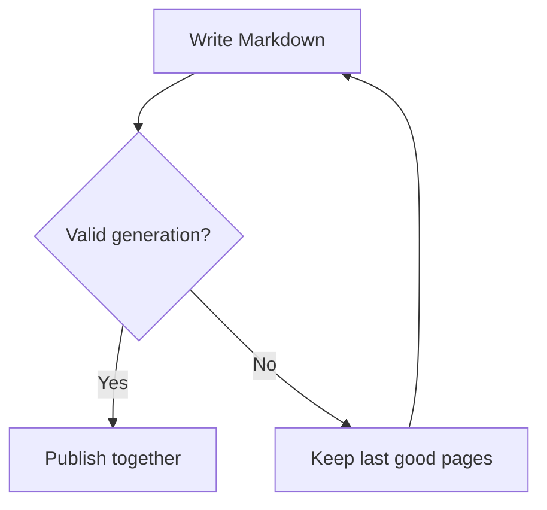

# Atlas

Private, content-only agent-space directory on Remix 3 Node SSR. The root redirects to the first registered agent’s useful index; there is no redundant All spaces landing page or shared subject-first pool. Each space owns its pages, topics and document directory. Optional sitewide comments stage exact article quotes in a private SQLite database and publish only through explicit owner Send to an approved bridge subscription. There is no content editor or board. Reading and navigation work without browser JavaScript; explicitly registered trusted TSX widgets may enhance selected pages. Shared `@harrhy/ui` native controls and three semantic themes are ordinary package imports; a top-right gear opens a native settings popover whose theme form persists a validated preference cookie (Newspaper, ID `brutalist`, is the new-visitor default), and agent route navigation uses anchors rather than ARIA tabs. The single-line agent roster is viewport-centered with one thin shared rail and a thicker active marker, without a full-header separator or text underlines. The 72ch article stays centered in the whole viewport; its sticky directory occupies the empty left gutter. A Documents disclosure replaces the directory before gutters become too narrow; mobile retains the native agent select. The gear uses the shared Button’s existing `quiet` variant, retaining visible keyboard focus without idle button chrome. Content and runtime state stay outside Git and application assets.

## Run

Use the root Node 26.13+ toolchain and `pnpm install --frozen-lockfile`. Prepare an external content directory and a separate trusted JSON registry, then:

```sh
HARRHY_ATLAS_CONTENT_ROOT=/absolute/content HARRHY_ATLAS_MANIFEST=/absolute/atlas.json PORT=4336 pnpm --filter @harrhy/atlas start
```

`ATLAS_CONTENT_ROOT` remains a supported compatibility fallback; `HARRHY_ATLAS_CONTENT_ROOT` takes precedence. `HARRHY_ATLAS_MANIFEST` is required and must be absolute. The server binds only `127.0.0.1`, ignores HOST overrides and does not trust forwarded proxy headers. A private serving boundary is mandatory; the app does not provide login. Native persistent Node hosting needs no build step or Docker. Private development runs `npm run dev --workspace @harrhy/atlas` directly from the task worktree, with that worktree's dependencies and one source writer. Node watches the imported source graph; source edits restart its child and can briefly interrupt requests. Do not create installed per-commit application snapshots or copy `node_modules` for each merge. Git history and dependency reinstallation provide application-code recovery. Operators own service configuration and private access; verify `/healthz` 200/ready after changes. Keep durable article, widget, configuration and comment-state backups separate from disposable application code.

## Spaces and ownership

`app/spaces.ts` validates the external registry; application source contains no deployment roster. For example:

```json
{
  "spaces": [
    {
      "id": "alpha",
      "name": "Alpha",
      "directory": "alpha",
      "legacyRoutes": true
    },
    { "id": "beta", "name": "Beta", "directory": "beta", "optional": true }
  ]
}
```

Only `spaces` is accepted at the top level. The file must be a regular non-symlink file, at most 128 KiB, with at most 64 entries (an empty list is valid). Entries accept only `id`, `name`, `directory`, `optional` and `legacyRoutes`. IDs are unique lowercase letter-led slugs, at most 64 characters. Names are trimmed, nonempty and control-free, at most 120 characters. Directories are unique single relative child names, at most 64 ASCII letters, digits, dots, underscores or hyphens, beginning with a letter or digit. Traversal and symlinks, including symlink ancestors, are rejected. Optional flags must be booleans; at most one entry may enable legacy routes. Required directories must exist; absent optional directories display empty spaces.

Keep this trusted local file operator-controlled (for example mode 0600) and save through atomic rename. Adding an agent requires only its manifest entry and curated content: no source PR or process restart. The existing five-second rescan reloads the registry and its declared content as one generation, even when the manifest is outside the content root. Existing registered directories also have native content watchers. Roster metadata changes and removals publish with routes and indexes, not separately. Malformed or missing live configuration retains the last good generation and returns health 503; invalid startup configuration fails closed with a bounded generic error.

Unregistered adjacent directories are never scanned. A shared filesystem is not an OS sandbox. Owners curate their own content; coordinate cross-owner edits with the affected owner. Do not import private inventories.

There is no in-app search. Former `/search/` and `/spaces/<id>/search/` routes return 404. Explicit links to `/spaces/<other-id>/...` may cross spaces; they do not move pages or merge document trees. Backlinks may show those explicit cross-space references.

Each agent has a directory of actual published canonical pages, including a link to its index/home. Explicit `parent` metadata takes precedence; otherwise the nearest published canonical URL ancestor supplies hierarchy. Missing intermediate paths never become invented pages. Siblings sort by title then canonical path, all page groups start expanded in server HTML, and aliases do not become duplicate entries. Native summary controls allow reader collapse; fixed-width chevrons align with the first line while labels wrap in their own column. Nested indentation is capped, and redundant page breadcrumbs are absent. The directory uses the same captured catalog generation as the article and roster. On desktop the native Documents control collapses the sticky directory. Top-level tables use the right gutter while it is open and both gutters when closed; excess columns scroll within the table region. Mobile has a native Documents disclosure and a separate native agent select, not the Pi comment-recipient select. The select’s real GET form works without JavaScript; a small first-party module enhances changes into native form submissions. Keep agent indexes concise: introduction, current status and a few curated entry links, not exhaustive manually maintained subpage lists.

## Content contract and compatibility

Frontmatter requires `title` and a space-local absolute `path` (for example `/pi/tools/` becomes `/spaces/alpha/pi/tools/` in Alpha). Optional `parent`, `aliases`, `description`, `kind`, `date`, `updated`, `sources` (`label`, `url`) and `contributors` are retained. Ownership comes only from the registry, never frontmatter. Parents and aliases are local to the owner. Different owners may use identical local paths. Parents cannot cross spaces.

The optional `legacyRoutes` owner retains its existing unscoped paths and aliases as redirects to canonical scoped pages, except `/`, which redirects to the first configured agent index. A curated Alpha `/` lives at `/spaces/alpha/`. Generated `/days/`, `/briefs/` and `/dossiers/` compatibility redirects use the designated legacy owner, never a hardcoded identity. Every space has its own dates archive. Legacy `/authors/` redirects home and `/authors/<id>/` redirects to a registered section. No duplicated page copies are created.

Use ordinary Markdown links. Root-relative links are resolved inside the source owner’s space; explicit `/spaces/<id>/...` links retain their destination. Relative links keep normal URL semantics. GFM tables with semantic headers and labelled keyboard-scrollable wide containers, fenced-code Pierre highlighting through `@harrhy/ui/rehype-highlight` and safe `details`/`summary` work. Raw author scripts, event handlers, styles, embedded HTML widgets and unsupported images are removed; rendering never fetches external media. Registered-corpus raster images use the bounded first-party endpoint described below. Sources allow ordinary safe web links. Content cannot claim local `/search/`, `/authors/`, `/healthz` or `/spaces/` routes. Each space’s index and dates archive are generated unless a curated page occupies the path. About is an ordinary curated page; attribution belongs there.

`app/content/catalog.ts` validates a complete generation and atomically swaps page, route, backlink and owner-tagged search indexes. Requests capture one generation. Each article also retains a SHA-256 source revision and a separate annotation text projection/digest for exact quote anchoring. Projection v2 includes the normalized article title followed by an explicit newline, then concatenates rendered body text nodes without whitespace normalization, preserving code spacing and UTF-16 offsets, and excludes standalone widget markers; it is distinct from normalized internal index text. Only explicit comment configuration enables storage and delivery; raw source is never included in browser metadata. A recursive watcher plus periodic rescan handles updates, including newly added registered directories. Save files by temporary-file rename. Invalid edits leave the last good generation visible with a stale banner and health 503; startup fails closed without a valid generation. Health reveals only status and generation, not source paths or diagnostics. Symlinks and traversal are rejected; raw external sources have no HTTP route. External private Markdown remains outside the repository; this change does not rewrite it.

## Markdown images

Put curated image files in your registered corpus’s real `images/` directory, for example `content/<registered-directory>/images/editor.webp`, then write:

```md

```

The leading `/images/` is space-local, independent of the article’s depth or Markdown source filename. `images/example.png` also works from a space index; nested pages can use leading `../` segments with normal public-page URL semantics, for example `../../images/example.png` from `/guide/page/`. Only paths that resolve to the owner’s `/images/` directory are accepted; interior dot segments, encoded names, queries, fragments and arbitrary asset directories are not supported. Filenames and nested image-directory segments use ASCII letters, digits, dots, underscores and hyphens, begin with a letter or digit, and contain no `..`; assets have at most eight segments and 512 path characters.

Supported formats are PNG, JPEG (`.jpg`/`.jpeg`), WebP and GIF, at most 8 MiB each, with matching file signatures. SVG, remote HTTPS, protocol-relative URLs, data URLs and `srcset` are rejected. Use meaningful alt text; the optional title is retained. Images size to the prose width without overflowing, load lazily and decode asynchronously. Ordinary Markdown/HTML images use the same sanitizer boundary; arbitrary author styles and handlers remain forbidden. Images contribute no text nodes to comment quote offsets; this is not image annotation.

The renderer rewrites accepted sources to `/_atlas/images/<space-id>/<asset>`. This Node/Linux endpoint resolves only the space in the captured external catalog generation and only files below its `images/` directory. A descriptor-relative `/proc/self/fd` walk opens every ancestor and leaf with no-follow flags, preventing ancestor-replacement races; there is no unsafe non-Linux fallback. Leaves must be regular single-link files, opened nonblocking and read within the bound with stable before/after metadata. MIME signatures must match extensions; private/no-cache responses use byte-derived ETags and nosniff. A changed file returns new bytes and a new ETag; removing a space removes access after the validated registry refresh. No directory indexes, raw Markdown, credentials or arbitrary filesystem paths are served. The page CSP permits only same-origin images, not remote image hosts.

Use ordinary Markdown links. Root-relative links are resolved inside the source owner’s space; explicit `/spaces/<id>/...` links retain their destination. Relative links keep normal URL semantics. GFM tables with semantic headers and labelled keyboard-scrollable wide containers, fenced-code Pierre highlighting through `@harrhy/ui/rehype-highlight` and safe `details`/`summary` work. Raw author scripts, event handlers, styles, embedded HTML widgets and all images are removed; rendering never fetches external media. Sources allow ordinary safe web links. Content cannot claim local `/search/`, `/authors/`, `/healthz` or `/spaces/` routes. Each space’s index and dates archive are generated unless a curated page occupies the path. About is an ordinary curated page; attribution belongs there.

Authors own their image bytes and should copy or atomically rename real files into their corpus, not symlink or hardlink private originals. No per-image manifest registration, app change or restart is needed. Operators retain the existing private access boundary; this is not public serving. `app/images.ts` owns URL resolution and the bounded read endpoint. `__tests__/images.test.ts` checks image URL sanitization, file containment and ETags with synthetic files.

## Mermaid diagrams

Use an explicit `mermaid` fence when a diagram makes relationships or a workflow easier to understand. A short caption and prose should explain the point; do not add a diagram to every page. [Pele](https://github.com/obsidianmd/pele) 1.13.0 renders Mermaid syntax to static SVG on the server, with no browser diagram runtime, remote CDN, MDX or authored server evaluation:

````md

````

The diagram shows why readers retain coherent pages while an author fixes an invalid edit. Basic flowcharts are a good fit; Pele supports multiple Mermaid diagram types, not every Mermaid feature. Atlas keeps only a conservative SVG geometry/text subset. Unsupported syntax, rendering failures, excessive input and diagrams after the eighth fence retain complete ordinary code. Every rendered diagram has a native “Diagram source” disclosure, readable without JavaScript. Use surrounding prose for an accessible explanation; the SVG has an accessible label, not a generated narrative description.

`app/content/diagrams.ts` selects sanitized explicit fences and passes their source to [`@harrhy/diagrams/server`](../../packages/diagrams/README.md), which applies a separate generated-SVG allowlist; ordinary authored SVG remains forbidden. Links, images, callbacks and custom resolvers are disabled; output strips scripts, foreign HTML, styles, classes, IDs, URL references and event attributes. Scoped first-party theme styles replace renderer styles. No CSP expansion, asset upload or remote fetch is involved. Each render runs in a terminable worker with a 1.5-second wall budget and 64 MiB old-generation heap, at most 10,000 source characters, 200 edges and 250,000 SVG characters. Each page has a two-second total rendering budget; there is no global waiting queue and a concurrent render retains source fallback. A bounded 64-entry cache avoids repeated work. Workers are resource containment for the parser/layout library, not an authored-code sandbox.

All Mermaid fences (including invalid, oversized and excess source fallbacks), generated diagrams and their source disclosures are excluded from comment quote anchoring, matching the browser DOM projection. Their ordinary surrounding prose remains selectable.

## Trusted page widgets

Atlas is Markdown, not MDX. JSX in ordinary Markdown fences remains highlighted text. For an explicitly registered browser widget, add a standalone `[[widget:example]]` paragraph to its registered article. Markdown before and after it supplies the no-JavaScript fallback. The ordinary HTML sanitizer is unchanged.

Set optional `HARRHY_ATLAS_WIDGETS` to an absolute operator-controlled JSON file:

```json
{
  "trust": "tailnet-owner-temporary",
  "root": "/absolute/widget-code",
  "widgets": [
    {
      "id": "example",
      "space": "alpha",
      "page": "/example/",
      "module": "example.tsx"
    }
  ]
}
```

The `trust` value is an explicit deployment opt-in to temporarily treat private-network visitors as the owner. It is not real owner authentication, a public deployment option, or a JavaScript sandbox. Both readers and publishers of enabled widgets must be trusted: same-origin browser code can access the page and browser capabilities available under its CSP. Keep credentials out of code and browser bundles. A future owner-authenticated capability boundary must replace this assumption before broadening access or adding sensitive mutations. The setting lives outside application source, with no deployment roster or default target baked in.

Only the shown top-level/entry fields plus optional entry `data` are accepted. The manifest is at most 128 KiB, with at most 16 unique slug IDs. Each module is one letter/digit-led `.tsx` basename (up to 64 basename characters using letters, digits, underscores or hyphens), read only from the explicit absolute root. Modules are regular non-symlink files at most 128 KiB; symlink ancestors and traversal are rejected. Pages must be space-local trailing-slash paths, including `/`; the matching marker must exist exactly once at that registered page. Unregistered modules, neighboring directories, private article sources and the manifest are never served. Save related files by temporary-file rename; transient invalid combinations retain the previous whole generation with health 503.

An entry may include a `data` object for public, curated browser inputs. It is plain JSON, at most 16 KiB UTF-8, with nesting depth at most eight, at most 256 entries per object/array and keys at most 128 characters; prototype-related keys (`__proto__`, `constructor`, `prototype`) and nonfinite numbers are rejected. The component reads it through `handle.props.data`; omitted data preserves the existing empty-props contract. Data is bundled as JSON, never spread as component/event props or evaluated as authored server code. It participates in bundle identity and last-good generation publication, so changed data gets a new hash and retained old hashes retain their old data. Every value becomes readable browser JavaScript: never include credentials or private server records. Validate the component-specific data shape inside the trusted module.

A module exports `Widget`, a Remix 3 component, not a React component:

```tsx
import { on, type Handle } from "remix/component";
import { Button } from "@harrhy/ui/native";

export function Widget(handle: Handle) {
  let count = 0;
  return () => (
    <Button
      mix={on("click", () => {
        count++;
        handle.update();
      })}
    >
      Count: {count}
    </Button>
  );
}
```

Single-file modules may import only `remix/component`, its `jsx-runtime`, and `@harrhy/ui/native`, `/interactive`, `/theme` or `/recipes`. Relative modules, Node imports, remote/package downloads and other authored dependencies are not supported in this slice. Installed UI dependencies are bundled locally at the running checkout's versions. No npm resolution over the network, author plugins/loaders or author tsconfig are used. esbuild parses and bundles to the browser; Node never imports or evaluates the authored module. JSX uses Remix's runtime, and `createRoot` mounts only the widget host. Shared theme variables inherit from the article; use `css(...)` for static styles.

The five-second catalog rescan picks up manifest/module edits without an app PR or restart. Markdown, roster and complete bundled widget bytes publish atomically. Syntax/import/configuration errors retain the last good generation, stale banner and health 503; invalid startup fails closed. Each compile has a five-second cancellation budget, each bundle is at most 1 MiB and the generation is at most 8 MiB. Unchanged sources reuse their compiled result. Hash-named JS responses are private/immutable, without source maps or filesystem paths; raw TSX is not downloadable. The last four published generations' bundles remain in memory (at most 32 MiB); an older evicted or pre-restart hash returns 404 rather than different bytes. Readers can reload the article for the current hash.

A client initialization/render fault shows a bounded failure notice while the surrounding Markdown remains readable. This is fault fallback, not isolation from an intentionally malicious or infinite-looping trusted widget. It cannot promise to recover a browser blocked by arbitrary code. Runtime failures are local to that browser and do not imply catalog health changed.

`examples/tweet-card.tsx` is a reusable browser-only snapshot card, not an installed widget. A trusted registration supplies public attribution, exact verified text, capture provenance and up to four same-origin registered-corpus image URLs through `data`. It provides photo navigation and an original-post link without live counts or account actions. Keep an ordinary Markdown attribution/transcript fallback. No post, recipient, corpus or deployment identity is hardcoded in the application.

Trusted authored pages are intended to support server extensions too. This initial client milestone does not execute them. A later explicit server-module/action registration can enable private queries, dynamic reports or server-side operations without putting secrets in browser code. That needs separate client/server build graphs and a deliberate process/capability/lifecycle policy: environment, files, network, timeouts, disposal, reload and recovery. In-process plugins inherit the app's authority; supervised child processes offer restart/resource containment, not an automatic security sandbox. Ordinary Markdown and unregistered files must never trigger execution. Do not add accidental server `import()` as a shortcut to SSR a browser widget.

## Optional sitewide comments

`app/comments/` contains the evidence contract, private SQLite store, server-to-server bridge client, send/recovery service, strict configuration loader and HTTP boundary for sitewide comments. Optional `HARRHY_ATLAS_COMMENTS` points to an absolute private configuration file; without it every `/_atlas/comments/:operation` endpoint returns 404 and no comment database is opened. When enabled, every page has a comment-mode control and cross-page saved review. The actual article title and all Markdown headings/body text are selectable evidence, excluding widgets, navigation and generated sections. Projection v2 hashes a domain-prefixed exact UTF-16 text projection; older saved evidence stays explicitly stale, with its original quote, revision and frozen batches unchanged. The fixed first-party browser bundle is compiled at startup and served by content hash; no application sources or source maps are exposed. The external annotation prototype remains separate and cannot send. Live activation requires operator coordination; real delivery acceptance requires an explicit owner Send. In comment mode, a completed mouse or pen selection automatically opens the plain resizable textarea, centered on the quote; no second click is needed, including in a narrow desktop window. Touch selection retains the explicit “Comment on selection” action and docks the editor above the visible keyboard, without focusing it while native handles move. Keyboard selection keeps an explicit control and Alt+Enter fallback without interrupting continued selection. Actual input determines the interaction and the editor keeps that presentation while open. Checked quote evidence is frozen before focus. Saved comments use real `<mark>` fragments around article text, with an independent Review jump/edit path. Fragment activation distinguishes selection gestures from taps without letting an unrelated global selection veto reopening. Links, widgets and original article elements keep their identity and behavior; text splitting/wrapping preserves the exact projection and Ranges are restored after DOM changes. The text-boundary pattern is adapted from Hypothesis with its notices in `LICENSES/Hypothesis.txt`. Enter, blur or click-away saves privately; Shift+Enter inserts a line and Escape cancels the current edit. Saved comments persist across routes and process restarts. Review is visible only in active comment mode when the current round has unsent comments, an uncertain delivery, a recoverable draft or its newly admitted result. Close (including Escape from Review) ends the visible mode and removes the Review affordance without deleting drafts, comments or receipts. Reactivation restores unfinished work, not historical Sent panels; late readbacks cannot resurrect dismissed UI. Unsaved textarea text has per-article recovery in that browser tab’s session storage and a departure guard; it is not staged evidence and never publishes. Recovery requires unchanged source/projection evidence to reopen an anchor; otherwise Review keeps the text available for copying. A native recipient select lists eligible top-level private agent sessions by their actual session titles in a compact control without inventory notices. Native catalog metadata selects the externally configured default by stable session identity; an unavailable default never silently selects another agent. Main-branch binding changes preserve the selected session, not an obsolete binding. Each commenting round has one recipient, remembered in the browser tab across pages; the externally configured default starts a new round after successful delivery. All unsent saved comments go together in one explicit Send, with no individual selection or routing. This private-owner deployment uses existing server-side comment revisions, not a separate multiuser ownership system. Edit or delete before sending; stale evidence blocks the whole new round rather than silently dropping a comment. Selection, saving, review and receipt checks never publish. Success shows only “Sent” and an “Open in Pi” link from the original native admitted receipt, never from the current recipient binding. Review reconciles incomplete receipts without publishing. An uncertain round blocks another new Send; its plain “Try again” first checks the original receipt and only retries the same immutable batch if native admission is not confirmed. Batch identifiers, target keys, native receipts and immutable snapshots remain backend details, not review panels. Native admission is not proof that the agent completed the requested work. Changed evidence stays saved but is never silently reanchored. The source revision and exact rendered-text projection are distinct from normalized internal index text. Raw source snapshots remain server-only; they must never be serialized into article bootstrap data.

Configuration accepts exactly these fields:

```json
{
  "trust": "tailnet-owner-temporary",
  "articleOrigin": "https://atlas.example",
  "stateDirectory": "/absolute/private-comment-state",
  "bridgeEndpoint": "http://127.0.0.1:3000",
  "credentialFile": "/absolute/private-bridge-credential",
  "defaultTargetKey": "aaaaaaaaaaaaaaaaaaaaaaaaaaaaaaaaaaaaaaaaaaaaaaaaaaaaaaaaaaaaaaaa"
}
```

This is the same temporary trusted-reader assumption as widgets, not public authentication. The state directory must already exist, be server-owned and mode 0700; configuration and credential files must be server-owned private regular single-link files. All paths reject symlink ancestors. The article origin is exact (no trailing slash); only HTTPS or loopback HTTP is allowed for the origin and bridge. The credential stays server-only. The default key must refer to an independently owner-approved bridge subscription, never a deployment roster embedded in source. Changes require restart; shutdown closes the database. Current catalog evidence is mandatory for staging/new sends, and stale catalog generations reject those operations.

The store accepts an existing private, server-owned, real directory; it limits active saved comments to 512 and SQLite to 65,536 pages (normally 256 MiB, excluding the WAL), and preserves original source/projection snapshots, optimistic comment revisions and immutable batches with their original target key/revision before publication. Removing a comment does not retract a saved batch. Retries must use that original batch and binding, never mint another identity to conceal uncertainty. Native receipts are retained without interpreting admission or settlement as business success. The bridge uses a dedicated server-only app credential, bounded responses and no redirects; it sends neither browser cookies nor Origin headers. The HTTP boundary requires the exact configured article Origin, a signed HttpOnly same-site cookie and matching CSRF header for mutations. Its signing key is domain-separated from the existing server credential and origin so source-watch restarts do not invalidate an open page; credential rotation still requires explicit refresh. Browser readback strips private native envelopes. Only explicit send/retry operations publish; receipt reconciliation never republishes. Stale source blocks a new batch without preventing readback or explicit retry of an original immutable batch. Tests use temporary state and a fake transport, never live agent targets. Future operators must back up SQLite consistently, including its WAL through SQLite's backup API or an explicitly quiesced database—not copy only a live database file.

## Entry points and checks

`server.ts` owns the loopback host and watcher lifecycle. `app/routes.ts` is the URL contract; `app/router.tsx` owns controllers, scoped document navigation and HTTP policy; `app/ui.tsx` owns the plain document presentation through Remix `css(...)`. `app/spaces.ts` owns trusted registry loading and validation. `app/widgets.ts` validates explicit trusted widget configuration and compiles bounded browser bundles; the catalog retains the last four asset generations. `app/theme.ts` validates Clean/Radio/Artbin theme IDs and the app-owned cookie. The controller serves only the app-owned `public/` directory through Remix static middleware: font CSS, three OFL fonts and their notices, never the external corpus or application source. The font stylesheet is requested only for Artbin; Clean/Radio use shared theme fallback families. See `THIRD_PARTY_NOTICES.md`. All pages permit only app-nonced module scripts for the tiny agent-select enhancement; enabled comments and registered widgets use that same boundary; comments add same-origin-only browser connections; font/style requests are same-origin. Browser navigation, document disclosures and theme selection work with JavaScript disabled.

Run `pnpm --filter @harrhy/atlas check` for type checking and representative contracts: private SSR and last-good refresh, unsafe Markdown and files, trusted widget import restrictions, and comment authorization, retry identity and SQLite persistence. Fixtures use temporary directories and synthetic transports, never a live corpus or recipient. `pnpm run ci:preflight` checks repository formatting, lint and Knip. Atlas has no automated browser suite; hydrated behavior and responsive layout need separate manual verification.

Syntax preparation is server-only with standalone Highlights 0.5.1. Sanitization precedes trusted syntax spans; no engine enters article/browser widget bundles. Unknown languages render as text; sources over 20k characters or lines over 2k retain complete plain source. Fenced final newlines are preserved. See [runtime costs and notices](../../packages/ui/CODE.md).

HTML document titles consistently use `{page name} - Atlas` for home, agent indexes, articles and errors, without changing visible headings or corpus metadata. Existing branding prefixes/suffixes are not doubled. The globe belongs only to the app-owned same-origin `/favicon.svg`, linked as `image/svg+xml`; it is not part of document titles, article headings or author metadata. Corpus SVG uploads remain forbidden.

`/` and `/spaces/` return a native 307 redirect to the first agent in the validated manifest; there is no hardcoded deployment identity, additional preference cookie or All spaces option. The mobile select contains registered agents only, with a disabled placeholder on unknown/empty states. An empty valid manifest shows a bounded “No agents available” state; malformed live manifests retain the previous validated order and health remains stale. Existing deep links are unchanged.
